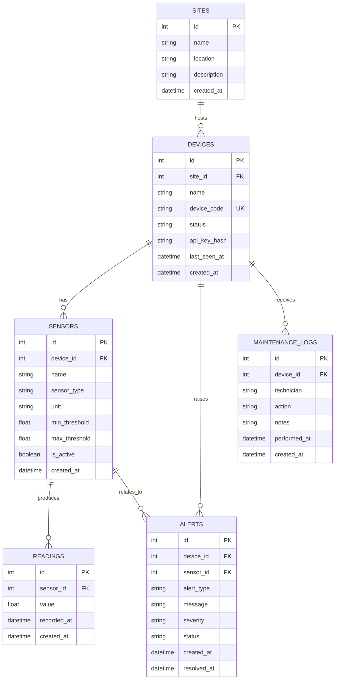

# Entity Relationship Diagram (ERD)

Diagram berikut dapat dirender oleh GitHub Markdown yang mendukung Mermaid.

## Ringkasan relasi

- `sites` 1:N `devices`: satu lokasi dapat memiliki banyak perangkat.
- `devices` 1:N `sensors`: satu perangkat dapat memiliki beberapa sensor.
- `sensors` 1:N `readings`: satu sensor menghasilkan banyak data telemetri.
- `devices` 1:N `alerts`: satu perangkat dapat menghasilkan banyak alert.
- `sensors` 1:N `alerts`: alert dapat terkait dengan sensor tertentu; `sensor_id` dapat kosong untuk alert tingkat perangkat.
- `devices` 1:N `maintenance_logs`: riwayat pemeliharaan disimpan per perangkat.

Semua tabel menggunakan `id` sebagai primary key. Kolom berakhiran `_id` yang merujuk tabel lain adalah foreign key. `devices.device_code` memiliki unique constraint.
